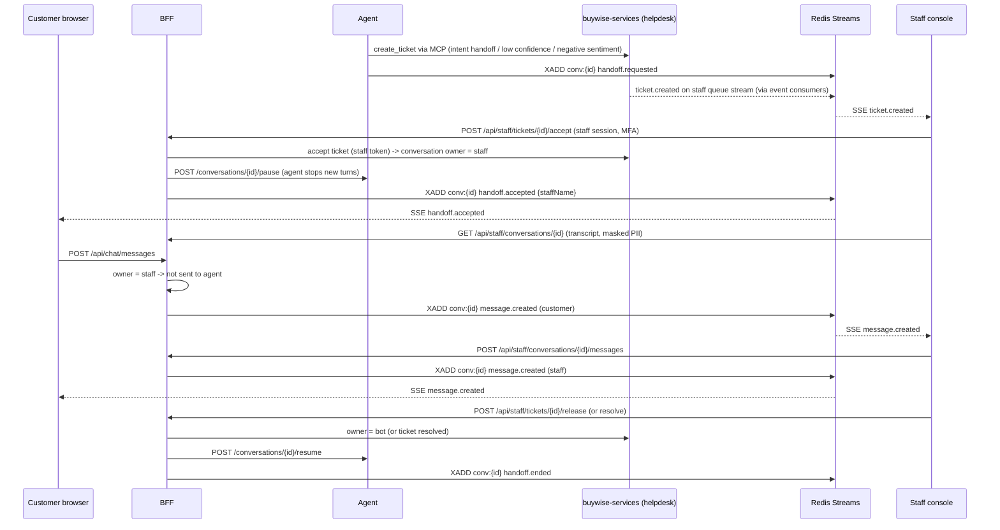

# UI + BFF (`buywise-web`) - Detailed Design

Part of [00_Architecture_Overview.md](00_Architecture_Overview.md) - agent-buywise-shop. Status: Draft.

## 1. Purpose and responsibilities
- **Angular web app:** customer chat widget, product/cart/order views; staff console (ticket queue, take over chat).
- **NestJS BFF:** login/session, SSE streaming of agent replies and live events, screen aggregation. No business logic.
- **One deployable:** the BFF serves the built Angular files (`/`), its API (`/api/**`) and the chat event stream (`/api/chat/stream`, SSE) from one origin.

## 2. Technology and versions
| Part | Choice | Why |
|---|---|---|
| Web | Angular 22 (signals, Signal Forms, zoneless, Vitest), TypeScript 6 | Stable signal-first APIs, long support window |
| BFF | Node.js 24 LTS, NestJS 11 + Fastify adapter | Structure (modules, DI, guards), SSE support, fast HTTP engine |
| Component library | Angular Material (Material 3) + Angular CDK, custom theme (ADR-019) | Released with Angular, strongest built-in accessibility, data table for staff console, token-based theming |
| Styling | SCSS with Material 3 design tokens; no Tailwind | One styling system; tokens shared by both apps |
| Rendering | Hybrid per route: prerender + client; no per-request SSR (ADR-023) | Fast indexable product pages; BFF stays a file server |
| Charts (AI Operations only) | Apache ECharts, modular imports, own signal-based wrapper component; "view as table" toggle (ADR-038) | Richest chart set, canvas performance, built-in aria descriptions; no third-party Angular wrapper to lag behind upgrades |
| State management | NgRx SignalStore + signals + `httpResource` (ADR-022) | Consistent store structure where state is shared or live; plain signals elsewhere |

**Rendering per route (ADR-023):**
| App / routes | Render mode | Notes |
|---|---|---|
| customer-web: product and category pages | Prerender (build time) | Price and stock fetched live in the browser after load |
| customer-web: chat, cart, checkout, account | Client | Personal, interactive, SSE is browser-only |
| staff-console: all routes | Client | Behind login, no SEO need |
- No per-request SSR: the BFF serves files only and runs no Angular rendering engine.
- Code that runs during prerender must guard browser-only APIs (`EventSource`, `window`, `localStorage`), e.g. `afterNextRender` / platform checks.
- Catalog content changes need a rebuild; switch product routes to Server mode later if the catalog grows or changes often.

**State management rules (ADR-022):**
| State | Tool | Examples |
|---|---|---|
| Local to one component | Plain signals | Form step, panel open/closed |
| Read-only server data | `httpResource` | Product details, order history |
| Shared across screens or updated by SSE | NgRx SignalStore (`withEntities` for collections) | Chat store (in `shared`), session store, cart store, staff ticket queue store |
- SSE events are fed into stores through one stream-to-store adapter in `shared`; components never read the SSE stream directly.
- Verify `httpResource` is stable in Angular 22 before implementation.

**Component library usage (ADR-019):**
- `staff-console`: Material components directly (table, sort, paginator, forms, dialogs, side panels).
- `customer-web`: custom Material 3 theme (neutral store look, not default Material style).
- Chat UI (message list, bubbles, streaming text, product cards) is custom-built in `shared` on CDK primitives (a11y, overlay, scrolling).
- Theme tokens live in `shared` so both apps stay consistent.
- No product images anywhere: product cards and pages use placeholder graphics (ADR-033).

## 3. Module structure
**App structure (ADR-018):** one Angular workspace with two applications and a shared library.
```
ui/
├── web/                    # Angular 22 workspace
│   ├── projects/
│   │   ├── customer-web/   # served at /       - chat widget, products, cart, orders
│   │   ├── staff-console/  # served at /staff  - ticket queue, conversation takeover, AI Operations (ops-admin)
│   │   └── shared/         # library: chat components, message models, API clients, UI primitives
└── bff/                    # NestJS 11 (auth, chat, customer, staff, ops, health, common)
```
- Each app has its own Keycloak client: staff can get stricter login rules (MFA, shorter sessions) than customers.
- Customers never download staff code; Envoy can restrict `/staff/**` (and `/api/staff/**`) separately.
- `shared` holds only code used by both apps; app-specific code stays in its app. Neither app imports from the other.
- Still one deployable: the BFF serves both builds from one origin.

Packaging: multi-stage Docker build -> both `ng build` outputs copied into the BFF image.

## 4. Interfaces
- Browser <-> BFF: REST (screens) + SSE (live events), same origin, httpOnly session cookie.

**Session pattern (ADR-021): BFF session (token handler).**
- BFF is the OIDC client: Authorization Code + PKCE with Keycloak; tokens stored server-side in Redis, never sent to the browser.
- Browser holds only an opaque session cookie: `__Host-` prefix, `HttpOnly`, `Secure`, `SameSite=Lax`.
- Guest sessions: browse and chat without login; login required for checkout and order history; guest order status via OTP.
- On login the session id is rotated (prevents session fixation); the guest conversation carries over.
- Staff: own Keycloak client and own cookie scoped to `/staff` and `/api/staff`; shorter idle timeout; MFA required.
- Session limits: idle and absolute timeouts in Redis (values set with NFR targets).
- CSRF: `SameSite` cookie + required custom header on every state-changing request.
- BFF calls `buywise-services` (screens, staff actions) with the user's or staff member's token, and refreshes it when it expires.
- Calls to `buywise-agent` use a token exchanged for `aud: buywise-agent` (ADR-028); staff takeover actions never go through the agent.

**Real-time channel (ADR-020): SSE down, HTTP POST up.**
| Direction | Mechanism | Example |
|---|---|---|
| Browser -> BFF | `POST /api/chat/messages` (any pod) | Customer or staff sends a message |
| BFF -> browser | `GET /api/chat/stream` (SSE, `EventSource`) | Agent reply tokens, staff messages, ticket queue updates, order status |

- Event delivery and replay (ADR-029): every conversation has a Redis Stream (`conv:{id}`), capped by count and time. The agent appends reply events; the BFF appends staff messages, handoff and ticket events. The BFF pod holding the SSE connection reads the stream (one shared reader per pod, multiplexed over its SSE connections) and forwards events. No sticky sessions, no pub/sub.
- SSE `id` = Redis Stream entry id; on reconnect the browser sends `Last-Event-ID` and the BFF reads the stream from that point. Staff console streams that span several Redis Streams (queue + taken-over conversations) use a composite cursor - detail at implementation.
- Sending a turn: BFF calls agent `POST /turns` (202 Accepted); stop button -> `POST /api/chat/turns/{id}/cancel` -> agent cancel.
- Heartbeat comment every ~15 s keeps idle streams open through Envoy and proxies.
- Envoy serves HTTP/2 to browsers, so open streams don't hit the HTTP/1.1 per-site connection limit.
- Planned upgrade: WebSocket for the staff takeover conversation only, if typing indicators / read receipts are needed (see ADR-020).

**Chat message contract (ADR-024):** own typed contract; agent-reply events shaped like AG-UI start/content/end.

SSE envelope:
```
id: 1793212800123-0
event: message.delta
data: {"v":1,"ts":"2026-10-28T14:02:11Z","conversationId":"c_9f2","messageId":"m_77a","payload":{"text":"This phone has a 6.3-inch display"}}
```

| Group | Events |
|---|---|
| Agent reply (streamed) | `message.started`, `message.delta`, `message.completed`, `message.failed` |
| Whole messages | `message.created` (customer or staff message delivered to the other side) |
| Progress | `status.updated` (payload: `stage`, `label`, e.g. `tool_call` / "Checking stock...") - NFR 2 first visible feedback |
| Metrics (dev overlay only) | `message.metrics` (payload: `model`, `ttftMs`, `durationMs`, `inputTokens`, `outputTokens`, `tokensPerSec`, `costUsd`) |
| Rich content | `block.product_card`, `block.comparison`, `block.order_status`, `block.payment_link`, `block.store_pickup` |
| Handoff | `handoff.requested`, `handoff.accepted`, `handoff.ended` |
| Staff console | `ticket.created`, `ticket.updated` |
| Orders | `order.status_changed` |
| Heartbeat | SSE comment line (no event) |

Rules:
1. Versioning: `v` on every event; adding fields is allowed, renaming/removing bumps `v`; clients ignore unknown event types.
2. Rich content is data rendered by Angular components. Agent text is Markdown, sanitized, HTML stripped; LLM output is never inserted as raw HTML.
3. Replay: the SSE `id` is the Redis Stream entry id of the conversation stream (ADR-029); reconnect replays after `Last-Event-ID`; gap too old (trimmed) -> client reloads the conversation via REST.
4. Idempotent sends: `POST /api/chat/messages` carries a client-generated `clientMessageId`; duplicates are ignored.
5. Source of truth: JSON Schema in `shared/contracts/`; TypeScript (web, BFF) and Pydantic (agent) types generated from it; CI fails if generated types drift.
- BFF -> `buywise-agent`: chat requests, streamed responses.
- BFF -> `buywise-services`: order history, staff console data (JWT from the session; no internal gateway).

## 5. Key flows
Sequence diagrams (Mermaid, rendered by GitHub). Each step names the decision it comes from.

### 5.1 Guest visit and customer login (ADR-021)
```mermaid
sequenceDiagram
    participant B as Browser
    participant W as BFF
    participant R as Redis
    participant K as Keycloak
    B->>W: GET / (no cookie)
    W->>R: create guest session (id, guest=true)
    W-->>B: Set-Cookie __Host-sid (HttpOnly, Secure, SameSite=Lax)
    Note over B,W: Guest browses and chats (public scopes only, ADR-028)
    B->>W: GET /api/auth/login?returnTo=/checkout
    W-->>B: 302 to Keycloak (Authorization Code + PKCE, state, nonce)
    B->>K: login (customer client)
    K-->>B: 302 /api/auth/callback?code=...
    B->>W: GET /api/auth/callback?code=...
    W->>K: exchange code + PKCE verifier (confidential client)
    K-->>W: access, refresh, ID tokens
    W->>R: new session id (rotation), store tokens, copy guest conversation id, delete guest session
    W-->>B: Set-Cookie new __Host-sid, 302 returnTo
    Note over W: Next agent turn carries a token with sub=customer; agent links the guest conversation to the customer only if it belongs to this session
```
- Logout: `POST /api/auth/logout` (CSRF header) -> delete Redis session -> Keycloak RP-initiated logout. Keycloak back-channel logout also deletes the BFF session (e.g. account disabled).
- Session timeout warning (ADR-025): BFF exposes remaining idle time; UI warns 2 min before and offers "stay signed in".

### 5.2 Chat turn with streaming reply (ADR-020, ADR-024, ADR-028, ADR-029, ADR-030, ADR-036)
```mermaid
sequenceDiagram
    participant B as Browser
    participant W as BFF
    participant K as Keycloak
    participant A as Agent
    participant M as buywise-mcp
    participant S as buywise-services
    participant R as Redis Stream conv:{id}
    B->>W: GET /api/chat/stream (SSE, cookie) - open once per tab
    W->>R: shared reader subscribes to conv:{id}
    B->>W: POST /api/chat/messages {clientMessageId, text} (CSRF header)
    W->>W: dedupe clientMessageId; check conversation owner = bot
    W->>R: XADD message.created (customer)
    W->>K: token exchange -> aud buywise-agent
    W->>A: POST /turns (token, conversationId, messageId)
    A-->>W: 202 Accepted {turnId}
    A->>R: XADD status.updated "Thinking..."
    A->>A: route (rules -> fast -> LLM), Presidio placeholders
    A->>K: token exchange -> aud buywise-mcp, intent scopes
    A->>R: XADD status.updated "Checking stock..."
    A->>M: tools/call check_stock
    M->>K: token exchange -> aud buywise-services
    M->>S: GET /inventory/...
    S-->>M: stock
    M-->>A: result
    A->>R: XADD message.started, message.delta x N, block.product_card, message.completed
    R-->>W: events
    W-->>B: SSE events (id = stream entry id)
```
- Stop button: `POST /api/chat/turns/{id}/cancel` -> agent cancels -> `message.completed` (partial) or `message.failed`.
- Reconnect: browser auto-reconnects with `Last-Event-ID`; any BFF pod reads `conv:{id}` from that id; if trimmed -> `GET /api/chat/conversations/{id}` (REST reload).
- Overload / budget / failure behavior: docs/00 section 7.3 (queue position via `status.updated`, fallback model, FAQ + handoff).

### 5.3 Staff takeover (handoff)

- Ownership (ADR-037): helpdesk module in `buywise-services` is the source of truth; BFF caches it in Redis (`conv:{id}:owner`), updated on accept/release and refreshed from helpdesk events; agent is paused/resumed as a second check.
- Staff actions never go through the agent (ADR-028); staff messages use the staff member's own token.
- Staff sees masked contact details; "Reveal" is audited (ADR-036).
- Planned upgrade: WebSocket for typing indicators in takeover (ADR-020).

**LLM observability in the UI (ADR-027):**
- **staff-console > AI Operations** (Keycloak role `ops-admin`; routes `/staff/ai-ops/**`, API `/api/staff/ops/**`):
  1. Live summary: TTFT p50/p95, tokens/sec, full-answer latency, error rate, spend today vs global budget, current model (refreshes every 15 s via `httpResource`).
  2. Conversation explorer: search/filter conversations; per-turn breakdown by stage (route, RAG retrieval, tool calls, generation) with latency, tokens, cost, model, budget events; router tier that decided (rules / fast / LLM), intent(s) and confidence (ADR-030).
  3. Budget and pricing: read-only view of caps, shadow prices and degradation thresholds (config is changed in Git, not in the UI).
  4. Ingestion (ADR-039): upload documents (any supported format), see parse status, parse metrics, per-element preview with provenance, and quarantined files with reasons; re-parse action.
- **customer-web developer overlay:** TTFT, tokens and cost under each agent message, from `message.metrics`. Enabled by config (`devOverlay: true`), off by default; never on in production.
- Data source: BFF `ops` module reads the agent's usage tables (docs/07) via the agent API; Grafana remains the place for alerts and long-range trends.

## 6. Non-functional
- 2 replicas locally: any pod can serve any SSE connection by reading the conversation's Redis Stream (ADR-029); no sticky sessions.
- Reconnect: covered by ADR-020/ADR-024 (SSE auto-reconnect + `Last-Event-ID` replay). Browser support: last 2 versions of Chrome, Edge, Firefox and Safari (desktop), Safari on iOS and Chrome on Android - matches Angular 22's supported browsers; enforced via `browserslist` and Playwright projects (Chromium, Firefox, WebKit).

**Accessibility (ADR-025): WCAG 2.2 AA, automated + manual checks.**
- Automated: angular-eslint template accessibility rules; axe-core inside Playwright end-to-end tests in CI (fails the build on serious/critical issues).
- Manual checklist per release: keyboard-only pass, VoiceOver (macOS) and NVDA (Windows) on main flows, 200% zoom.
- Chat UI requirements:
  1. Streaming replies: message marked `aria-busy` while streaming; completed reply announced once via a polite live region (never token by token).
  2. Focus: new messages never move focus; Enter sends, Shift+Enter adds a line; the chat widget must not hide the focused element (2.4.11 Focus Not Obscured).
  3. Target size: interactive controls at least 24x24 px (2.5.8).
  4. Session timeouts: warn before timeout and allow extending (2.2.1), especially the shorter staff sessions (ADR-021).
  5. Accessible authentication (3.3.8): OTP field allows paste and autofill; no puzzle CAPTCHAs.
  6. Redundant entry (3.3.7): checkout never asks again for data already given.
  7. Reduced motion: typing animation and transitions off under `prefers-reduced-motion`.
  8. Rich blocks (`block.*`): semantic HTML (real tables, headings, lists).

## 7. Testing
- Vitest (web), Jest (BFF), Playwright end-to-end - TBD.
- Accessibility: axe-core checks in Playwright; manual checklist per release (ADR-025).

## 8. Open decisions
1. UI design decisions - all decided 2026-10-28 (ADR-018 to ADR-025):
   - ~~App structure~~ - decided: two apps + shared library (ADR-018)
   - ~~Component library~~ - decided: Angular Material + CDK, custom theme (ADR-019)
   - ~~Real-time channel~~ - decided: SSE + HTTP POST (ADR-020)
   - ~~Session pattern~~ - decided: BFF session / token handler (ADR-021)
   - ~~State management~~ - decided: NgRx SignalStore + signals + httpResource (ADR-022)
   - ~~Rendering~~ - decided: hybrid per route, prerender + client (ADR-023)
   - ~~Chat message contract~~ - decided: own typed contract, AG-UI-shaped reply events (ADR-024)
   - ~~Accessibility~~ - decided: WCAG 2.2 AA, automated + manual (ADR-025)
2. Future option: serve Angular files from a CDN, BFF only as a service.
3. ~~Chart library for AI Operations~~ - decided: Apache ECharts with own wrapper (ADR-038).
